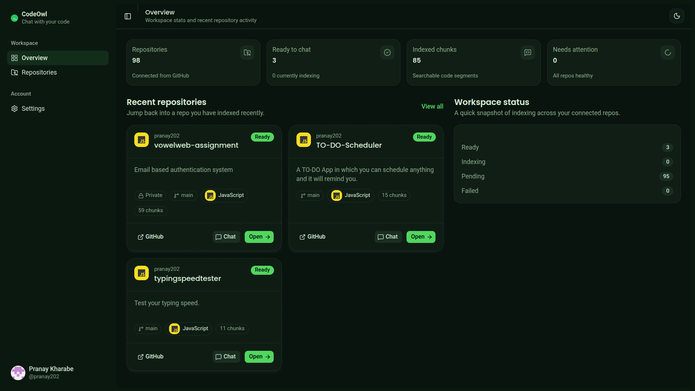
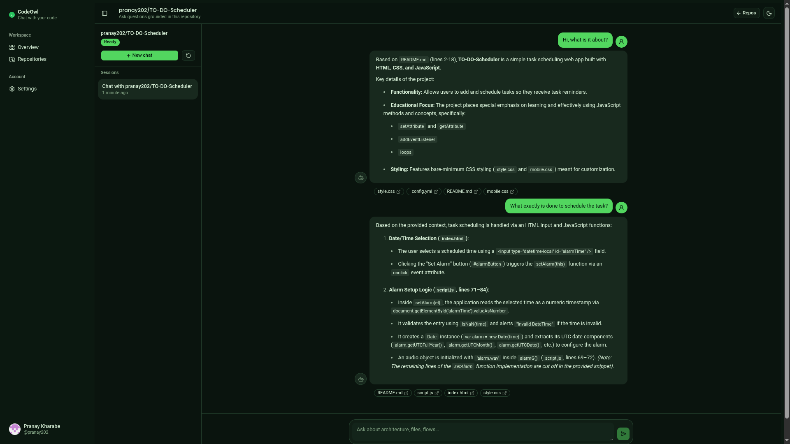

# CodeOwl

> Connect GitHub, index a repository, and chat with your codebase using grounded AI answers and source citations.

CodeOwl is a full-stack developer tool for understanding GitHub repositories faster. Sign in with GitHub, sync your repositories, index the code you want to explore, and ask questions in a streaming chat backed by retrieval-augmented generation (RAG).

## What you can do

- Sign in securely with GitHub OAuth.
- Sync public and private repositories from GitHub.
- Index supported source files into PostgreSQL with `pgvector`.
- Ask questions about an indexed repository in a streaming chat.
- See file and line citations alongside AI responses.
- Track indexing progress and start separate chat sessions per repository.

## Product tour

### Overview



### Synced repositories


### Repository chat



### Start a new conversation


## How it works

```text
GitHub OAuth
     ↓
Sync repositories
     ↓
Index code → chunk files → create embeddings → store in pgvector
     ↓
Ask a question → retrieve relevant code → generate a cited answer
```

Only eligible code and project files are indexed. Common generated, dependency, and build directories such as `node_modules`, `.git`, `dist`, `build`, `target`, and `.next` are skipped.

## Tech stack

| Area | Technology |
| --- | --- |
| Frontend | Next.js 16, React 19, TypeScript, Tailwind CSS |
| Backend | Spring Boot 4, Spring Security, Spring AI |
| Authentication | GitHub OAuth 2.0 |
| Database | PostgreSQL 16 with `pgvector` |
| AI providers | OpenAI by default, or Google Gemini |
| Chat transport | Server-sent events (SSE) |

## Run locally

### Prerequisites

- Node.js and npm
- Java 21
- Docker with Docker Compose
- A GitHub OAuth app
- An OpenAI API key, or a Gemini API key

### 1. Start PostgreSQL

From the repository root:

```bash
docker compose up -d postgres
```

The database is exposed on port `5433` on your machine.

### 2. Configure the backend

Create `backend/.env`:

```dotenv
DB_URL=jdbc:postgresql://localhost:5433/codeowl
DB_USERNAME=postgres
DB_PASSWORD=postgres

# Use "openai" or "google-genai"
AI_PROVIDER=openai
OPENAI_API_KEY=your_openai_api_key

GITHUB_CLIENT_ID=your_github_client_id
GITHUB_CLIENT_SECRET=your_github_client_secret

# Use long, private values in real environments.
TOKEN_ENCRYPTOR_PASSWORD=change-this-password
TOKEN_ENCRYPTOR_SALT=1234567890abcdef

FRONTEND_URL=http://localhost:3000
CORS_ALLOWED_ORIGINS=http://localhost:3000
```

For Gemini, set `AI_PROVIDER=google-genai`, provide `GEMINI_API_KEY`, and remove or leave `OPENAI_API_KEY` empty. Chat and embeddings must use the same provider for a repository’s vectors to remain compatible.

In your GitHub OAuth app, set the authorization callback URL to:

```text
http://localhost:8080/login/oauth2/code/github
```

### 3. Start the backend

```bash
cd backend
./mvnw spring-boot:run
```

On Windows, use `mvnw.cmd spring-boot:run` instead.

The API runs at `http://localhost:8080`.

### 4. Start the frontend

In a second terminal:

```bash
cd client
cp .env.example .env.local
npm install
npm run dev
```

The client runs at [http://localhost:3000](http://localhost:3000).

## First-use flow

1. Open the client and choose **Continue with GitHub**.
2. Approve the requested repository access.
3. Open the repository dashboard and sync repositories if needed.
4. Start indexing a repository and wait until its status is **Ready**.
5. Create a chat and ask a question about the codebase.

Chat is available only after indexing completes successfully. Answers are generated from the retrieved repository context; when the context is insufficient, the assistant is designed to say so.

## Useful commands

### Frontend

```bash
npm run dev       # development server
npm run build     # production build
npm run start     # serve the production build
npm run lint      # lint the client
```

### Backend

```bash
./mvnw spring-boot:run   # run locally
./mvnw test              # run tests
./mvnw package           # build the application
```

## Configuration notes

- `NEXT_PUBLIC_API_BASE_URL` controls which API the browser calls. It defaults to `http://localhost:8080`.
- The Docker Compose database uses host port `5433`; keep that port in `DB_URL` unless you change the Compose mapping.
- Repository access tokens are encrypted before they are stored. Keep `TOKEN_ENCRYPTOR_PASSWORD` and `TOKEN_ENCRYPTOR_SALT` stable for an existing database.
- Changing AI providers or embedding dimensions after vectors exist may require clearing and re-indexing repository vectors.
- Do not commit `.env`, `.env.local`, API keys, OAuth secrets, or encryption values.

## Project layout

```text
.
├── backend/       Spring Boot API, OAuth, indexing, RAG chat
├── client/        Next.js web application
├── docker/        PostgreSQL initialization scripts
├── output/        Product screenshots used in this README
└── docker-compose.yml
```

## License

No license has been declared in this repository yet. Add a license before distributing CodeOwl outside your team.
